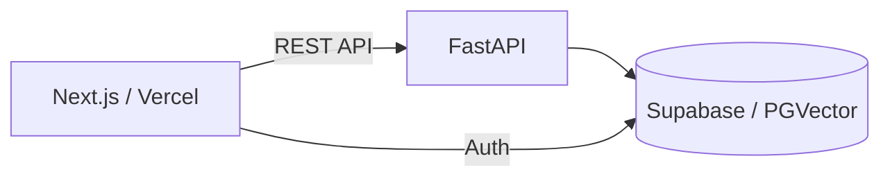

# 설계 문서

시스템 구조와 데이터 모델을 정리합니다.

> **ERD · 클래스 다이어그램 (데이터 모델):** 현재 상세 모델은 [진행보고서(상세설계) §3](../reports/진행보고서-상세설계.md#3-설계-결정-진행-상황)에 정리되어 있습니다. DB 구현 시 이 문서를 기준으로 삼고, 필요 시 아래 `erd.md` / `db-schema.md` 로 분리·발전시키세요.

## 넣을 문서 예시

- `architecture.md` — 시스템 아키텍처 (Next.js ↔ FastAPI ↔ Supabase)
- `erd.md` — ERD (엔티티 관계도)
- `db-schema.md` — DB 테이블/컬럼 정의
- `wireframe.md` — 화면 설계 / 와이어프레임

## 다이어그램

- 간단한 구조도는 [Mermaid](https://mermaid.js.org/) 로 작성하면 GitHub에서 바로 렌더링됩니다.

